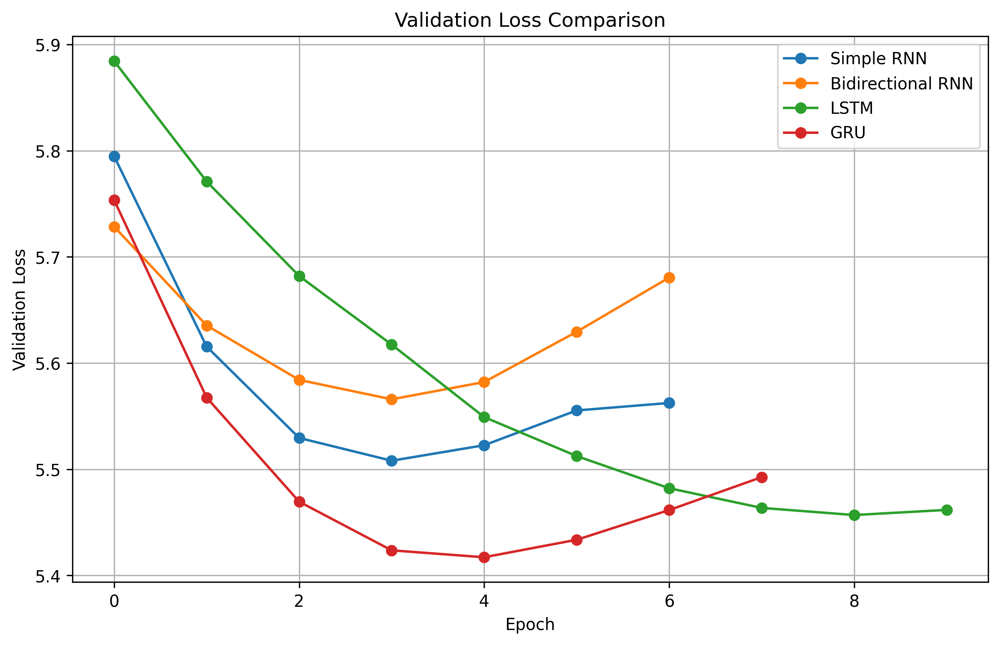
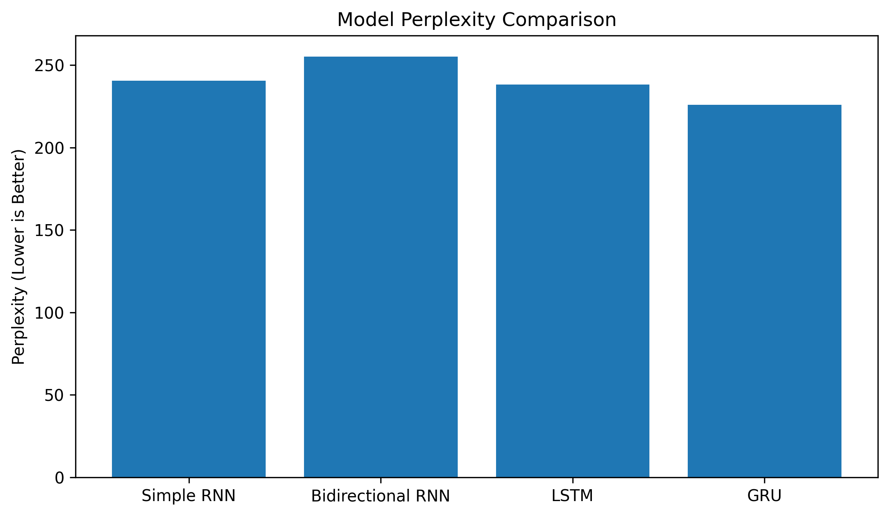

# Autoregressive Text Generation Using RNN, BiRNN, LSTM and GRU

## 1. Project Overview

This project was developed as part of **Foundations of Generative AI (ICT4403) – Assignment 2**.

The objective is to implement and compare four recurrent neural network architectures for word-level autoregressive text generation:

- Simple Recurrent Neural Network (RNN)
- Bidirectional Recurrent Neural Network (BiRNN)
- Long Short-Term Memory (LSTM)
- Gated Recurrent Unit (GRU)

The models predict the next word from a sequence of previous words and generate text iteratively.

## 2. Dataset

**Dataset:** The Complete Works of William Shakespeare

**Source:** [Project Gutenberg](https://www.gutenberg.org/ebooks/100)

The original dataset contains approximately 966,506 words and 5.57 million characters.

For computational efficiency, a subset of approximately 500,000 characters was selected, beginning with Shakespeare's sonnets.

### Preprocessing

The following operations were performed:

1. Removed the Project Gutenberg header and introductory table of contents.
2. Converted text to lowercase.
3. Removed numbers and special characters while preserving apostrophes.
4. Normalized whitespace.
5. Split the dataset into training (80%), validation (10%) and testing (10%).
6. Created a vocabulary of up to 5,000 words.
7. Converted words into integer tokens.
8. Generated input–target pairs using a sliding window of 20 words.

## 3. Model Architectures

All four models use an embedding layer, a recurrent layer and a Dense output layer with softmax activation.

| Component | Configuration |
|---|---|
| Input sequence length | 20 words |
| Vocabulary size | 5,000 |
| Embedding dimension | 64 |
| Recurrent units | 128 |
| Output activation | Softmax |
| Optimizer | Adam |
| Loss function | Sparse categorical cross-entropy |
| Batch size | 128 |
| Maximum epochs | 10 |

The Bidirectional RNN uses 128 units in each direction.

### Model Descriptions

**Simple RNN:** Processes input sequences sequentially while maintaining a hidden state.

**Bidirectional RNN:** Processes the provided context in both forward and backward directions.

**LSTM:** Uses memory cells and gating mechanisms to learn longer-term dependencies.

**GRU:** Uses update and reset gates to control information flow with a simpler recurrent architecture than LSTM.

## 4. Training

All models were trained using the same dataset partitions, batch size, optimizer and maximum epoch configuration.

Early stopping was applied with a patience of three epochs, monitoring validation loss and restoring the best model weights.

## 5. Experimental Results

| Model | Test Loss | Perplexity | Test Accuracy | Training Time |
|---|---:|---:|---:|---:|
| Simple RNN | 5.4827 | 240.4953 | 11.08% | 25.78 s |
| Bidirectional RNN | 5.5420 | 255.1772 | 10.69% | 31.46 s |
| LSTM | 5.4728 | 238.1209 | 11.65% | 45.63 s |
| **GRU** | **5.4204** | **225.9705** | **12.14%** | **34.67 s** |

Perplexity was calculated using:

\[
\text{Perplexity} = e^{\text{Cross-Entropy Loss}}
\]

Lower perplexity indicates better next-word predictive performance on the same test dataset.

### Training Observations

- Simple RNN had the shortest training time.
- Bidirectional RNN had the largest number of parameters but the weakest test performance.
- LSTM achieved competitive predictive performance but required the longest training time.
- GRU achieved the lowest test loss and perplexity and the highest test accuracy.

## 6. Temperature-Based Text Generation

All four models generated text autoregressively using identical seed sequences.

Three sampling temperatures were evaluated:

- **0.5:** More concentrated probability distribution, producing more predictable words.
- **1.0:** Uses the original learned probability distribution.
- **1.5:** Flattens the probability distribution, increasing the likelihood of less probable words.

Three seed sequences were used for each model–temperature combination, producing 36 generated samples.

### Diversity and Repetition Analysis

Text diversity was evaluated using:

- **Distinct-1:** Ratio of unique generated words to total generated words.
- **Distinct-2:** Ratio of unique generated bigrams to total generated bigrams.
- **Repeated-bigram proportion:** One minus Distinct-2.

The experiments generally showed increasing lexical diversity as temperature increased.

At lower temperatures, generated text was more predictable but sometimes repetitive. Higher temperatures increased vocabulary variation, although many outputs became less coherent.

### Coherence and Contextual Consistency

Generated samples were manually inspected for grammatical structure, meaningful phrases, topic continuity and repetition.

The models frequently produced Shakespeare-style vocabulary and short recognizable phrases, but the continuations often lacked complete grammatical and contextual consistency.

Distinct-1 and Distinct-2 measure lexical variation rather than semantic coherence.

### Detailed Qualitative Comparison

The generated text was examined for coherence, contextual consistency, lexical diversity and repetition across three seed sequences and three sampling temperatures.

| Model | Distinct-1 at T=0.5 | Distinct-1 at T=1.0 | Distinct-1 at T=1.5 |
|---|---:|---:|---:|
| Simple RNN | 0.789 | 0.956 | 0.989 |
| Bidirectional RNN | 0.767 | 0.967 | 1.000 |
| LSTM | 0.789 | 0.956 | 0.967 |
| GRU | 0.778 | 0.933 | 1.000 |

The results indicate that increasing sampling temperature generally increased lexical diversity across all four models.

At temperature 0.5, the Simple RNN and Bidirectional RNN showed repeated bigrams, while GRU also exhibited some repeated patterns. LSTM showed no repeated bigrams across the three sampled continuations at this temperature.

At temperatures 1.0 and 1.5, no repeated bigrams were detected in the generated continuations. However, the absence of repeated bigrams does not guarantee grammatical correctness or semantic coherence.

Manual inspection revealed that all four models generated recognizable Shakespeare-style expressions but struggled to maintain consistent meaning across longer passages.

GRU achieved the best quantitative performance, with a test accuracy of 12.14% and perplexity of 225.97. It was therefore selected as the most effective model for this experimental configuration, while acknowledging the limitations of its generated text.

## 7. Visualizations

### Validation Loss

### Perplexity Comparison

## 8. Project Files

- `FGAI_Assignment2_Text_Generation.ipynb` — Complete implementation.
- `results/training_summary.csv` — Training statistics.
- `results/model_evaluation_results.csv` — Test metrics.
- `results/generated_text_samples.csv` — Generated text at different temperatures.
- `results/text_quality_comparison.csv` — Diversity and repetition results.
- `results/validation_loss_comparison.png` — Validation loss graph.
- `results/perplexity_comparison.png` — Perplexity graph.

## 9. Execution Instructions

1. Open the Jupyter Notebook in Google Colab.
2. Select a GPU runtime if available.
3. Execute the cells sequentially.
4. Download and preprocess the Shakespeare dataset using the notebook.
5. Train the four neural network models.
6. Evaluate the trained models.
7. Generate text using the specified sampling temperatures.
8. Run the comparison and visualization cells.

### Dependencies

- Python
- TensorFlow / Keras
- NumPy
- Pandas
- Matplotlib
- Requests

The project was developed using Google Colab with TensorFlow 2.21.0.

## 10. Limitations

- The training corpus was relatively small.
- The vocabulary was restricted to 5,000 words.
- The input context was limited to 20 words.
- Removing punctuation reduced sentence-structure information.
- Generated passages were not consistently grammatically coherent.

## 11. Conclusion

Among the four architectures, **GRU achieved the best quantitative performance** for the selected Shakespeare dataset and experimental configuration.

It obtained a test accuracy of 12.14% and perplexity of 225.97, with a training time of approximately 34.67 seconds.

Although GRU provided the best predictive performance, all four models showed limitations in long-form text coherence and contextual consistency.

The experiment demonstrates how recurrent architecture and sampling temperature influence autoregressive text generation.
